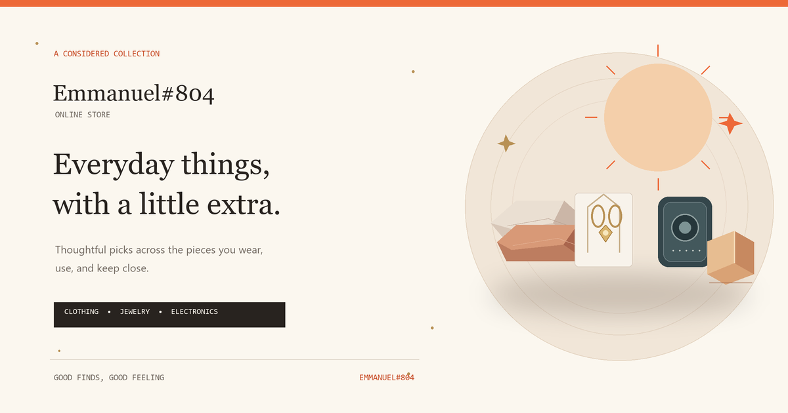

# Emmanuel#804 Online Store

A responsive, single-page e-commerce storefront built with React and Vite. Browse products from FakeStoreAPI, search and filter the catalog, manage a persistent shopping cart, and complete a simulated checkout.

- **Live site:** [task-4-zeta-seven.vercel.app](https://task-4-zeta-seven.vercel.app/)
- **GitHub repository:** [eolusoga-804/task-4](https://github.com/eolusoga-804/task-4)



## Contents

- [Overview](#overview)
- [Features](#features)
- [Shopping and checkout behavior](#shopping-and-checkout-behavior)
- [Technology](#technology)
- [Project structure](#project-structure)
- [Getting started](#getting-started)
- [Available commands](#available-commands)
- [Configuration and customization](#configuration-and-customization)
- [Accessibility and responsive behavior](#accessibility-and-responsive-behavior)
- [SEO and social preview](#seo-and-social-preview)
- [Deployment](#deployment)
- [Known limitations](#known-limitations)

## Overview

Emmanuel#804 Online Store is a front-end shopping experience for exploring everyday products across clothing, jewelry, and electronics. It demonstrates a product catalog, interactive filters, quantity-aware cart management, and a complete demo checkout flow.

Product information is retrieved from the public [FakeStoreAPI](https://fakestoreapi.com/products). The storefront does not use a custom backend, user accounts, or a payment provider. Cart contents and the first-visit search-tip preference are stored in the shopper’s browser.

## Features

### Product discovery

- Fetches the product catalog from FakeStoreAPI.
- Displays product images, titles, categories, prices, ratings, and customer-favorite badges.
- Searches product titles, descriptions, and categories as the shopper types.
- Filters by Electronics, Jewelry, Clothing, or all products.
- Sorts by featured order, ascending price, descending price, or rating.
- Shows the current number of matching products.
- Displays loading, empty-result, and request-error states.
- Provides a retry action when the catalog request fails.
- Shows the full product description in a card overlay:
  - Hover or keyboard focus on larger screens.
  - Long press on touch screens.
  - Scrolls within the overlay if a description exceeds its available height.

### Search shortcut and first-visit tip

- Press **Ctrl+K** on Windows and Linux, or **⌘K** on Apple platforms, to focus the search field.
- Displays the platform-specific shortcut inside the empty search input.
- Shows a first-visit tip near the top of the page:
  - Mobile, tablet, and smaller screens explain that the search field can be tapped.
  - Wider screens display the keyboard shortcut.
- The tip’s action focuses the search field.
- Dismissing the tip saves the preference in browser `localStorage`.

### Shopping cart

- Adds products from catalog cards to the cart.
- Opens as a slide-out panel beneath the sticky header.
- Shows an item count in the header.
- Supports increasing and decreasing quantities, removing individual products, and clearing the cart after checkout.
- Saves cart contents in browser `localStorage`, so the cart is restored on a later visit in the same browser.
- Calculates the subtotal, shipping, estimated tax, and final total.
- Blurs the page behind the open cart panel.

### Product-added confirmation

After a product is added, a centered pop-up displays that product’s image, name, description, price, and rating. It dismisses automatically after a short interval, and also provides a close button.

### Demo checkout

- Opens a checkout dialog from the cart.
- Collects a name and email address using browser form validation.
- Generates a demo order confirmation number.
- Clears the cart after the shopper continues from the confirmation screen.
- Does not collect payment details or send customer information to a server.

### Visual design and motion

- Uses a compact editorial layout with orange accents, serif and sans-serif typography, and CSS Grid.
- Keeps the main content within a maximum width of 1,140px.
- Adapts the product grid from two columns on narrow screens to three columns on medium screens and four columns on wider screens.
- Animates the catalog and closing-note headings with a repeating typing effect.
- Brings product cards into view one after another and adds entrance effects to selected controls and sections.
- Adds decorative artwork to the hero and footer.
- Disables supported animations when the shopper’s operating system requests reduced motion.

## Shopping and checkout behavior

The cart uses the following demo calculations:

| Amount | Rule |
| --- | --- |
| Subtotal | Sum of each item’s price multiplied by its quantity |
| Shipping | $6.99 when the subtotal is below $75 |
| Free shipping | Applies at a subtotal of $75 or more |
| Estimated tax | 8% of the subtotal |
| Total | Subtotal + shipping + estimated tax |

These values are demonstration settings, not tax or shipping estimates from a real service. The rates and threshold are configurable in `src/data/storeContent.js`.

## Technology

- **React 19** for the component-based interface and state.
- **JavaScript ES modules** for application logic.
- **Vite 8** for local development and production builds.
- **CSS and CSS Grid** for styling and responsive layouts.
- **FakeStoreAPI** for product data.
- **Browser `localStorage`** for cart persistence and the dismissed-tip preference.

## Project structure

```text
.
├── public/
│   ├── favicon.svg
│   └── social-preview.png
├── src/
│   ├── components/
│   │   ├── ProductAddedToast/
│   │   ├── ProductCard/
│   │   └── ProductLoading/
│   ├── data/
│   │   └── storeContent.js
│   ├── hooks/
│   │   ├── useCart.js
│   │   └── useProducts.js
│   ├── sections/
│   │   ├── AnnouncementBar/
│   │   ├── CartDrawer/
│   │   ├── CheckoutModal/
│   │   ├── ClosingNote/
│   │   ├── Hero/
│   │   ├── ProductCatalog/
│   │   ├── StoreFooter/
│   │   └── StoreHeader/
│   ├── App.jsx
│   ├── App.css
│   ├── index.css
│   └── main.jsx
├── index.html
├── package.json
├── package-lock.json
├── vite.config.js
└── README.md
```

Each section and component keeps its stylesheet alongside its module. The central `src/data/storeContent.js` file stores storefront text, catalog labels and options, the API URL, currency settings, cart rates, and other shared values.

### Main application modules

- `src/App.jsx` connects the store sections, cart state, cart drawer, checkout dialog, and product-added confirmation.
- `src/hooks/useProducts.js` requests product data, handles loading and error states, supports retry, and cancels an outstanding request when the component is removed.
- `src/hooks/useCart.js` manages cart actions, browser persistence, item counts, and total calculations.
- `src/sections/ProductCatalog/` implements search, filtering, sorting, the result count, and product cards.
- `src/components/ProductCard/` displays individual product information and its description pop-up.
- `src/sections/CartDrawer/` displays cart items, quantity controls, and totals.
- `src/sections/CheckoutModal/` implements the simulated checkout and confirmation.
- `src/data/storeContent.js` centralizes editable copy and store settings.

## Getting started

### Requirements

Install Node.js **20.19 or later** or **22.12 or later**, along with npm.

### Install dependencies

```bash
npm install
```

### Start the development server

```bash
npm run dev
```

Vite prints the local development URL in the terminal. Open that address in a browser to use the store.

## Available commands

| Command | Purpose |
| --- | --- |
| `npm run dev` | Starts the local Vite development server. |
| `npm run lint` | Runs ESLint against the project. |
| `npm run build` | Creates the production build in `dist/`. |
| `npm run preview` | Serves the production build locally after it has been built. |

The project currently defines lint and build checks; it does not define an automated test command.

## Configuration and customization

### Store copy and settings

Edit `src/data/storeContent.js` to update the shared store text and settings, including:

- Store name, announcement, hero, catalog, and footer copy.
- Category labels and sort options.
- Search labels and shortcut instructions.
- Cart tax rate, shipping fee, free-shipping threshold, and storage key.
- Checkout labels and product-added confirmation text.

### Product source

The product API URL is configured as `storeContent.api.productsUrl` in `src/data/storeContent.js`. The current implementation uses FakeStoreAPI and expects a JSON array of products.

### Currency

The currency locale and currency code are configured in `storeContent.catalog.currencyLocale` and `storeContent.catalog.currencyCode`. Product prices and cart amounts use those settings for formatting.

### Local browser storage

The cart and search-tip dismissal use separate keys in `storeContent.js`. Clearing the site’s local storage resets the saved cart and allows the first-visit tip to appear again.

## Accessibility and responsive behavior

- Search and sort controls use labels, and the search field exposes its keyboard shortcut through `aria-keyshortcuts`.
- Catalog filters use button controls with `aria-pressed` to expose their selected state.
- Product-count changes and product-added messages use live status announcements.
- The cart and checkout dialogs expose dialog roles and accessible labels.
- The cart and checkout dialogs support Escape to close and manage keyboard focus while open.
- Interactive elements include visible keyboard-focus styles.
- Product descriptions can be opened with keyboard focus on larger screens or long press on touch screens.
- Layouts adapt for narrow screens starting at 320px.
- Reduced-motion preferences disable supported entrance and typing animations.

## SEO and social preview

Page metadata is configured in `index.html`, including:

- Page title and description.
- Canonical URL and robots directive.
- Open Graph title, description, URL, and image.
- Twitter card metadata.
- WebSite structured data.
- Favicon link.

The favicon and preview image are stored in `public/`. The current metadata points to the deployed Vercel URL. If the production domain changes, update the canonical, Open Graph, Twitter, and structured-data URLs in `index.html`.

## Deployment

The project is connected to GitHub and deployed on Vercel. The production build uses:

```bash
npm run build
```

Vite writes the generated static site to `dist/`. For a Vercel deployment, use the Vite framework preset, `npm run build` as the build command, and `dist` as the output directory. Push changes to the production branch configured in Vercel to trigger a new deployment.

- **Production site:** [task-4-zeta-seven.vercel.app](https://task-4-zeta-seven.vercel.app/)
- **Source repository:** [eolusoga-804/task-4](https://github.com/eolusoga-804/task-4)

## Known limitations

- Product availability depends on FakeStoreAPI and an active internet connection.
- The catalog is a demonstration and does not maintain stock, user accounts, or product inventory.
- Cart data is saved only in the current browser’s local storage; it is not synchronized across devices.
- Tax and shipping are example calculations and may not reflect real purchase costs.
- Checkout generates a local demo confirmation only; it does not process a payment, create a real order, or send customer data to a backend.
